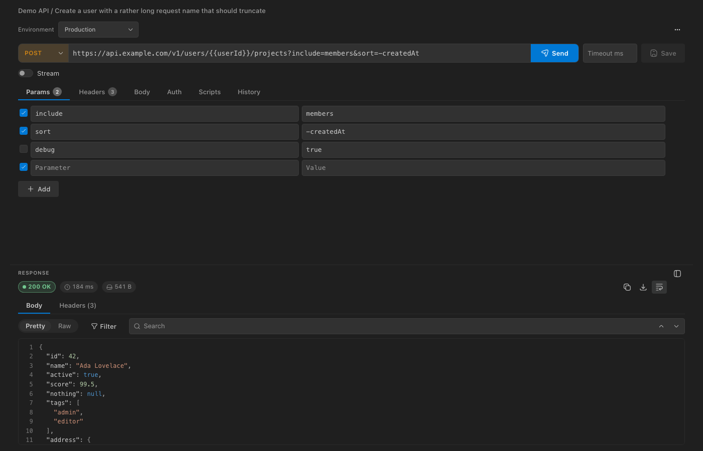
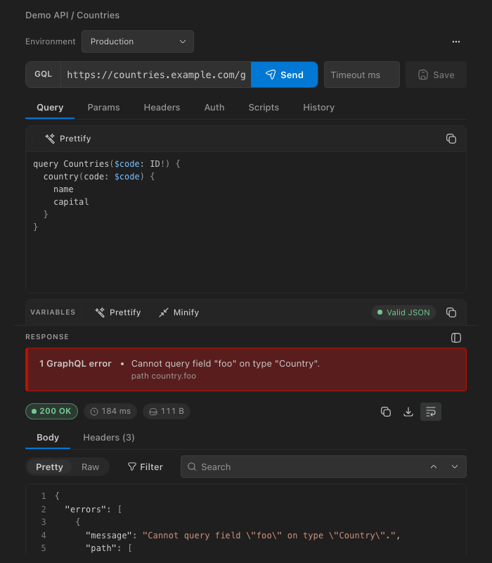
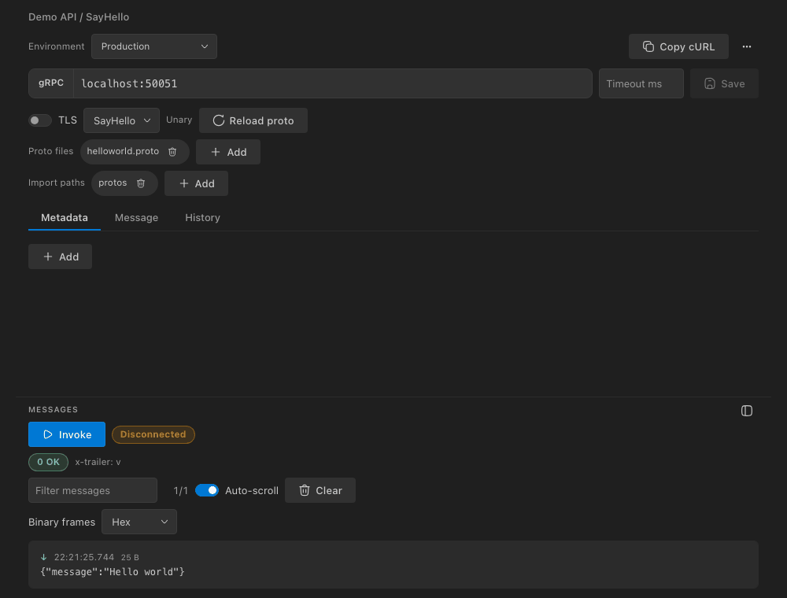
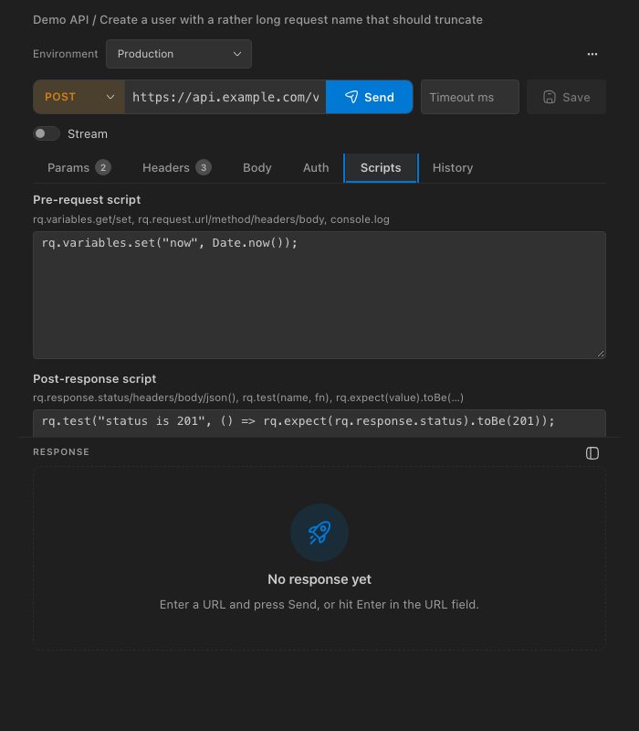
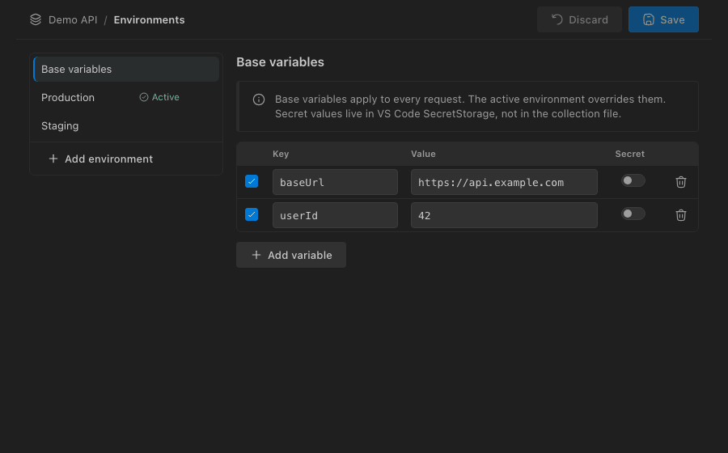

# Routiq

A lightweight Insomnia/Postman-like API client that lives inside VS Code: REST, GraphQL, WebSocket, SSE and gRPC, with collections you can keep in git.



## Features

- **Requests**: params, headers, bodies (JSON, XML, text, form, multipart, binary, GraphQL) and auth (bearer, basic, API key, OAuth 2.0, Digest).
- **Collections and folders** with drag-and-drop reordering, sorting (A→Z, Z→A, by method) and subcollections, one JSON file each, optionally stored in your workspace (`.routiq`) and committed to git.
- **Environments and variables**, including secret variables, with live `{{variable}}` highlighting (defined vs unresolved), hover values and autocomplete.
- **GraphQL** with schema introspection and completion, **Convert to GraphQL / HTTP** from the request toolbar **…** menu, **SSE**, **WebSocket** and **gRPC**.
- **Scripts and tests**: pre-request and post-response scripts, plus a collection/folder runner.
- **Response viewer**: syntax highlighting, pretty/raw, JSON path filter, search, save to file.
- **Import / export**: Routiq JSON, Postman v2.1, Insomnia, OpenAPI/Swagger and cURL; copy as cURL.
- **History**, cookie jar, redirects, proxy and TLS options.

## Quick start

1. Install Routiq and open the **Routiq** view in the activity bar.
2. Click **New Collection**, then add a request or import one (cURL, Postman, Insomnia, OpenAPI).
3. Enter a URL and press **Send**; **Save** or Ctrl/Cmd+S persists the request.

## Screenshots

| GraphQL | gRPC |
| --- | --- |
|  |  |

| Scripts and tests | Environments |
| --- | --- |
|  |  |

## Settings

| Setting | Default | Meaning |
| --- | --- | --- |
| `routiq.storagePath` | `""` | Where collections are stored; empty uses global storage. |
| `routiq.autoReveal` | `true` | Reveal the active request in the tree. |
| `routiq.history.maxEntries` | `50` | History entries kept per request. |
| `routiq.history.maxBodyBytes` | `262144` | Response bytes stored per history entry. |
| `routiq.timeoutMs` | `30000` | Request timeout. |
| `routiq.followRedirects` | `true` | Follow HTTP redirects. |
| `routiq.maxRedirects` | `10` | Maximum redirects followed. |
| `routiq.proxy` | `""` | Proxy URL; empty falls back to `http.proxy` and environment variables. |
| `routiq.rejectUnauthorized` | `true` | Verify TLS certificates. |
| `routiq.curlShell` | `auto` | Shell syntax for Copy as cURL: `auto` (PowerShell on Windows, bash elsewhere), `bash`, `powershell` or `cmd`. |
| `routiq.useVsCodeNetworking` | `true` | Send HTTP requests through VS Code's networking (system proxy/PAC, `http.proxy`, system certificates). Ignored when `routiq.proxy` is set. |
| `routiq.scripts.timeoutMs` | `5000` | Maximum run time of each script. |
| `routiq.runner.delayMs` | `0` | Delay between requests in the runner. |

## Security note on scripts

Pre-request and post-response scripts are JavaScript that runs on your machine. Only run scripts from collections you trust; Routiq asks for consent before running scripts of a collection and applies a time limit (see [Script security](#script-security)).

## Requirements

VS Code 1.85 or newer.

## Usage

1. Open the **Routiq** view in the activity bar.
2. **New Collection**, then right-click it (or use the inline buttons) → **New Request** or **New Folder**.
3. Click a request to open its editor: method, URL, Params / Headers / Body (none, JSON, XML, text, form-urlencoded, multipart form, binary file, GraphQL) / Auth (none, bearer, basic, API key in header/query, OAuth 2.0 client-credentials/password, Digest).
4. **Send** runs the request from the extension host (Node 18+ `fetch`, default 30 s timeout) and shows status, time, size, headers and a pretty-printed body.
5. **Save** or Ctrl/Cmd+S persists the request.

### Layout and appearance

The request editor and response share a resizable split: drag the divider (or focus it and use the arrow keys, double-click to reset) and use the layout button next to **Response** to switch between stacked and side-by-side. The choice is remembered. The method selector is colour-coded, tabs show counts of active params/headers, the response shows a coloured status badge with time/size chips, and the collections tree shows a coloured dot per HTTP method with a markdown tooltip. Everything uses VS Code theme colours, so it follows light, dark and high-contrast themes.

### Folders

A collection holds requests and nested folders (any depth). Right-click a collection or folder → **New Folder** / **New Request**; folders can be renamed, duplicated (with their contents) and deleted. **Drag and drop** in the tree moves requests and folders between folders and collections. Dropping on a collection or folder appends to it; dropping on a request places the dragged item before it when moving up and after it when moving down (VS Code does not expose the exact drop position). Dropping a folder on a sibling folder reorders them instead of nesting. A folder can't be moved into itself or its own subfolders. Order is stored in the collection file, so it is shared when the storage folder is committed.

### Sorting and moving

- **Sort** (collection or folder context menu → **Sort**): **A→Z**, **Z→A** or **by Method** (GET, POST, PUT, PATCH, DELETE, others, then name), each also as a **(Recursive)** variant. Folders come first, comparison is natural and case-insensitive. Sorting is a one-time reorder that is saved; you can keep dragging afterwards.
- **Sort Collections A→Z / Z→A** are in the view title **…** menu. Collections have **Move Collection Up/Down** in their context menu; dropping a collection on the empty area of the tree moves it to the end.
- **Subcollections**: drag a collection onto another collection or folder (or use **Move to…**) to turn it into a folder there. Its requests and folders move along; its base variables and environments are merged into the target without overwriting existing values (environments match by name), secret values follow into the target, and anything that could not be merged is listed in a warning. The active environment selection and the old collection's cookies are not carried over. **Promote Folder to Collection** (context menu, **Move to…** → *New top-level collection*, or dragging a folder to the empty area) does the reverse.
- **Move to…** (collection, folder and request context menu) is the keyboard alternative to drag and drop.

### Variables and environments

Use `{{name}}` in URL, params, headers, body and auth; unknown placeholders are left untouched.

Every collection has **base variables** and any number of **environments** (dev, staging, prod, …), each with its own key/value variables (enable/disable per row). One environment per collection can be **active**; its variables override base variables of the same name. With no active environment only base variables apply.

- **Manage**: collection context menu → **Manage Environments** (or the gear next to the environment dropdown in a request panel) opens an editor to add, rename, delete environments, set the active one and edit variables; **Save** or Ctrl/Cmd+S.
- **Switch**: the **Environment** dropdown in the request panel, the status bar item (`$(server-environment) <name>`, showing the collection of the focused request panel or selected tree item; click to switch), or **Routiq: Switch Environment**.
- The active environment is stored in the collection file (so it is shared if you commit the file).
- Collections created before environments existed keep their old variables as base variables; nothing is lost.

Dynamic variables resolve on every send (your own variables of the same name win): `{{$uuid}}`, `{{$timestamp}}` (seconds), `{{$timestampMs}}`, `{{$isoTimestamp}}`, `{{$randomInt}}` (0–999), `{{$randomString}}`, `{{$randomHex}}`, `{{$randomBoolean}}`.

### Secret variables

In the environment editor, click the lock next to a base or environment variable to mark it **secret**. Its value is shown masked and stored in VS Code **SecretStorage** (keyed by collection / environment / variable), never in the collection JSON file: the file keeps only the name and `"secret": true` with an empty value. Secrets are resolved at send time like any other variable, and are omitted from Routiq and Postman exports. Existing files are unaffected; a secret flag added by hand to a variable that still has a value in the file is migrated to SecretStorage on the next save in the editor. Secrets are per machine: they are not shared when you commit or copy the collection file, and duplicating a collection does not copy them.

### Searching and filtering requests

- **Search Requests** (`$(search)` button in the view title, or the command palette) opens a quick pick over every request (name, method, URL, collection/folder path) and opens the selected one.
- **Filter Requests in Tree** (`$(filter)` button) asks for text and fuzzy-filters the tree by request name, method or URL, keeping matching requests, their folders, and folders whose name matches; matching branches are expanded. The active filter is shown in the view message; **Clear Tree Filter** removes it.

### Variable highlighting and autocomplete

`{{name}}` placeholders are coloured wherever variables are substituted: the URL, params, header, form and multipart cells, body editors (JSON, XML, text, GraphQL query and variables, gRPC message), auth fields, WebSocket subprotocols and the environment editor values. Existing variables (environment, collection, dynamic and secret) are green; unresolved ones are orange with a wavy underline. Hover a variable to see its resolved value and scope (secrets show dots, never the value) or `Unresolved variable`.

Typing `{{` (or moving the caret into an unfinished `{{partial`) opens a list at the caret with the active environment's variables, collection variables, dynamic `$` variables and secret names, each with a value preview (masked for secrets) and its scope. Keep typing to filter; use ↑/↓ to move, Enter or Tab (or a click) to insert the variable with its closing `}}`, Esc to dismiss. The list follows the active environment. The headers table also suggests common header names. The WebSocket composer sends text as typed, so it is not highlighted.

### Authentication

OAuth 2.0 tokens are fetched by the extension host (client secret sent via HTTP Basic), cached in memory until shortly before expiry and refetched automatically on send; use **Fetch token** in the Auth tab to force a refresh. Digest auth (MD5/SHA-256, `qop=auth`) is applied by retrying once after a `401` challenge. Secrets are stored in the collection JSON file as plain text.

### Import / Export

- **Export**: toolbar (all collections) or collection context menu (one collection) → `.json`. **Export as Postman v2.1…** (collection context menu or command palette) writes a single collection as a Postman collection (formdata/urlencoded/graphql/binary bodies, bearer/basic/API key/digest/OAuth 2.0 auth, collection variables) and one `<environment>.postman_environment.json` file next to it per environment (secret values are blanked).
- **Import** (toolbar button, collection/folder context menu or **Routiq: Import…**) offers **From file…**, **From clipboard** and **cURL command…**. **Routiq: Import from Clipboard** (also a toolbar button) reads the clipboard and auto-detects the content:
  - a **cURL command** (starts with `curl`, optionally after `$ `) → a request in a chosen collection/folder;
  - a **Routiq export** or a single collection file (JSON);
  - a **Postman v2.1 collection** (JSON; nested `item[]` folders become folders; name, method, URL, headers, raw (JSON/XML/text), urlencoded, formdata (text/file), GraphQL and binary-file bodies, bearer/basic/API key/digest/OAuth 2.0 (client-credentials, password) auth, collection variables; pre-request and test scripts are translated best-effort to the `rq` API — `pm.environment/variables/collectionVariables/globals.set/get`, `pm.response.code/json()/text()`, `pm.test` and the common `pm.expect(...).to.equal/eql/include/above/below/…` and `pm.response.to.have.status` forms; lines that cannot be translated are kept as `// [not translated]` comments and reported as warnings; collection- and folder-level scripts are prepended to every contained request's script — pre-request outermost first, test scripts innermost first).
  - a **Postman environment** (`*.postman_environment.json`) → added as an environment of a chosen collection (right-click the collection, or you are asked); `secret` variables are stored in the secret vault.
  - an **OpenAPI 3.x / Swagger 2.0** document (JSON or YAML): one folder per (first) tag, URLs as `{{baseUrl}}/path/{{param}}` with `baseUrl` taken from `servers[0]` (or Swagger `host`/`basePath`), query/header parameters (optional ones disabled), example bodies generated from schemas, `multipart/form-data` bodies (binary properties become file fields), and `securitySchemes` mapped to request auth (http bearer/basic, apiKey in header/query and oauth2 `clientCredentials`/`password` flows with `tokenUrl` and scopes — the first usable scheme among alternatives wins; placeholders such as `{{bearerToken}}`/`{{apiKey}}` are added as empty collection variables);
  - an **Insomnia v4 export** (JSON): workspaces → collections, request groups → folders, requests with method/URL/headers/parameters/body (JSON/XML/text, form, multipart, GraphQL, binary file)/auth (bearer, basic, digest, API key, OAuth 2.0 client-credentials/password); the base environment → collection variables, sub-environments → environments (private environments and `secret` pairs become secret variables; pre-request scripts are not applicable and skipped).
  After every import an information message shows the counts of collections/folders/requests and the number of warnings, with a **Show details** action that opens the *Routiq Import* output channel listing each warning.
  Anything else shows an error saying what was expected (empty text, invalid JSON, unknown JSON shape). Files chosen with *From file* go through the same detection. IDs are regenerated on import; imported environments keep their active selection.

Export format (version 2; version 1 exports with a flat `requests` list still import):

```json
{ "version": 2, "collections": [
  { "id": "…", "name": "…",
    "variables": [{ "key": "", "value": "", "enabled": true }],
    "environments": [{ "id": "…", "name": "dev", "variables": [{ "key": "", "value": "", "enabled": true }] }],
    "activeEnvironmentId": "…",
    "items": [
      { "id": "…", "name": "Folder", "items": [ /* requests and folders */ ] },
      { "id": "…", "name": "…", "method": "GET", "url": "", "params": [], "headers": [],
        "body": { "type": "none|json|text|form", "text": "", "form": [] },
        "auth": { "type": "none" } } ] } ] }
```

### cURL

- **Import cURL** (**Routiq: Import cURL**, or from a collection/folder context menu) takes a command from the input box or the clipboard and creates a request in the chosen collection/folder. Supported: method (`-X`, `-I`/`--head`; implied `POST` with data), URL (also `--url`), `-H`, `-d`/`--data`/`--data-raw`/`--data-binary`/`--data-ascii`/`--data-urlencode` (repeated parts joined with `&`), `--json`, `-G`, `-u` (basic auth), `--oauth2-bearer`, `Authorization: Bearer …` headers (become bearer auth), `-A`, `-e`, `-b`, single/double/`$'…'` quoting, Windows commands (`curl.exe`, cmd `^` escapes and `^`-newline continuations as in Chrome's *Copy as cURL (cmd)*, PowerShell quoting with backtick escapes and continuations), backslash escapes, `\`-newline continuations and clustered short flags (`-sSXPOST`). The body type is inferred from `Content-Type` (JSON, form-urlencoded → form rows, otherwise text); JSON of the shape `{query, variables}` becomes a GraphQL body. `-F`/`--form` (text and `@file`) and `--form-string` become a multipart body, `--data-binary @file` a binary body. `-d @file`, `-F name=<file` and unsupported methods are ignored with a warning; irrelevant flags (`-L`, `-k`, `--compressed`, `-o`, …) are skipped.
- **Paste cURL into the URL field** (HTTP and GraphQL requests): pasting a command that starts with `curl` replaces the current request's method, URL, query params (moved into the Params table), headers, body and auth with the parsed command, keeping its name. A notice says *Imported cURL*, lists any warnings (ignored flags…) and offers **Undo**; it dismisses itself after a few seconds. Other pastes behave normally.
- **Copy as cURL**: button in the request panel and request context menu. Variables (active environment included) are substituted and auth is applied, so the command is ready to run. On Windows (or with `routiq.curlShell`) the command uses `curl.exe`, PowerShell quoting with backtick continuations, or cmd quoting with `^` continuations, so it runs in that shell. Digest auth is emitted as `--digest -u user:password`; OAuth 2.0 uses the cached token if one was fetched, otherwise the `Authorization` header is omitted and a warning says so.

### Network

- **Cookies**: a per-collection cookie jar honours `Set-Cookie` (domain, path, expiry, `Secure`), is applied across redirects and persisted in the extension's global storage. Use **Routiq: Manage Cookies** to view/delete/clear.
- **Redirects**: `routiq.followRedirects` (default on) and `routiq.maxRedirects` (default 10). 301/302 on POST and 303 switch to GET without body; 307/308 keep method and body. `Authorization`/`Cookie` headers are dropped on cross-origin hops.
- **Proxy / TLS**: `routiq.proxy` (falls back to `http.proxy`, then `HTTPS_PROXY`/`HTTP_PROXY`, honouring `NO_PROXY`) and `routiq.rejectUnauthorized` (set to `false` for self-signed certificates).
- **Timeout**: `routiq.timeoutMs` default, overridable per request via the timeout field next to Send. Hover the response time for a wait/download breakdown.

### Request kinds: SSE and WebSocket

**New Request** first asks for the kind; the tree shows a kind icon and label (`SSE`, `WS`) instead of the HTTP method. Params, headers, auth, `{{variables}}`, environments and the timeout work for every kind. SSE, WebSocket and gRPC sessions are recorded in the request's History (see below).

- **Server-Sent Events** (kind *Server-Sent Events*, or an HTTP request with **Stream** ticked): **Connect** / **Disconnect** opens a streaming `GET` (`Accept: text/event-stream` added unless set) and lists events live (name, id, retry, multi-line data) with timestamps, filter, auto-scroll and clear.
- **WebSocket**: `http(s)://` URLs are mapped to `ws(s)://`. Set request headers and comma-separated subprotocols, then Connect. The composer sends text or JSON (with Format and validation); the log shows direction (↑ sent, ↓ received), timestamp and size, with filter, auto-scroll and clear.
- **Auto-reconnect** (optional) retries after an unexpected close, honouring the SSE `retry:` value (default 3 s).
- WebSocket and SSE connections honour the proxy settings (`routiq.proxy` / `http.proxy` / env, via `https-proxy-agent` for WebSocket), send the collection's cookie jar and store `Set-Cookie` from the upgrade/stream response. Binary WebSocket frames are flagged and can be shown as **Hex** or **Base64** with the *Binary frames* selector.

### gRPC

Choose **gRPC** in New Request (tree label `gRPC`). `@grpc/grpc-js` and `@grpc/proto-loader` are bundled into the extension.

- **Target**: `host:port` in the URL field (a `grpc://` prefix is stripped), plus a **TLS** toggle (certificate checks follow `routiq.rejectUnauthorized`).
- **Schema**: add one or more `.proto` files and optional import paths with the file dialog. The methods are listed in the method dropdown with their call type (unary, server/client/bidirectional streaming). Selecting a method fills the **Message** tab with an example JSON body built from the request message fields (replaced only while the message is empty or still the previous example). Field names use the `.proto` spelling; `int64` values and enums are exchanged as strings.
- **Metadata**: the **Metadata** tab (key/values, `-bin` keys take base64). The timeout field is the call deadline (empty means none).
- **Calls**: **Invoke** sends the Message for unary and server-streaming calls. For client-streaming and bidirectional calls the composer sends each message and **End stream** half-closes; **Cancel** aborts. The log shows sent/received messages, and the final status code, details and trailers appear above it.
- `{{variables}}` work in the target, proto paths, metadata and message.

Limitations: server reflection is not supported (a `.proto` file is required); metadata and trailers are shown as text; calls are recorded in history as capped transcripts and run by the collection runner (unary calls, or the first 20 messages of a stream).

### Body formatting

JSON, XML and text bodies have a **Prettify** button (or `Shift+Alt+F` in the editor) and JSON bodies also a **Minify** button. JSON is indented with two spaces, key order and number precision are kept, and `{{variable}}` placeholders stay intact, even unquoted (`{"id": {{userId}}}`). Invalid JSON is left unchanged and the error is shown with its line and column; a live Valid/Invalid indicator sits under the JSON editor. The same Prettify/Minify buttons, `Shift+Alt+F` shortcut, error positions and live indicator are available in the GraphQL Variables editor, the gRPC message editor and the WebSocket composer's JSON mode. XML is re-indented while keeping text, CDATA, comments and declarations; text bodies containing JSON or XML are formatted accordingly and otherwise trimmed.

### GraphQL

Choose **GraphQL** in the New Request picker (tree label `GQL`). The method is fixed to POST and the request is sent as a `{ query, variables, operationName }` JSON body. Existing POST requests with a GraphQL body type open in the same editor, and GraphQL bodies from cURL, Postman and Insomnia imports become GraphQL requests.

- **Query tab**: syntax-highlighted query editor, a Variables JSON editor with validation, and an operation selector that appears when the document contains several named operations. **Prettify** formats the query and variables.
- **Schema explorer**: **Fetch schema** runs the standard introspection query through the normal send pipeline (variables, environments, auth, cookies, proxy; scripts are skipped). The schema is cached in the extension's global storage per resolved URL and reloaded when the request opens. Search types, fields and arguments, and click a field to insert it into the query.
- **Autocomplete**: with a schema loaded, field and type suggestions appear while typing (`Ctrl+Space` to force them).
- **Errors**: entries in the response `errors[]` are listed above the response with their path, location and code. The full response stays in the response viewer, and *Copy as cURL* works as for any request.

### Scripts and tests

Each request has a **Scripts** tab with a pre-request and a post-response script (JavaScript). Scripts run in an isolated `node:worker_threads` worker (one per script run) with capped memory (64 MB old generation, 16 MB young generation, 2 MB stack), a hard wall-clock timeout of `routiq.scripts.timeoutMs` (default 5000 ms) after which the worker is terminated, and no access to host objects. Inside the worker the code runs in a frozen `node:vm` context with no `require`, `process`, `fs`, timers, `fetch`, dynamic `import()` or string evaluation (`eval`/`new Function`); the `rq` API is a snapshot of variables, request and response, and results are passed back by message. Stopping a collection run aborts the in-flight request and any running script. They are saved with the request.

```js
// pre-request
rq.variables.set('nonce', String(Date.now()));
rq.request.headers['X-Nonce'] = rq.variables.get('nonce');

// post-response
rq.variables.set('token', rq.response.json().token);
rq.test('created', () => rq.expect(rq.response.status).toBe(201));
console.log('took', rq.response.timeMs, 'ms');
```

- `rq.variables.get(name)` / `rq.variables.set(name, value)` — values are strings. Writes are saved into the active environment (or the collection variables when none is active), so later requests can use `{{name}}`. Secret variables are never overwritten by scripts.
- `rq.request` — `url`, `method`, `headers` (object), `body` (text). Edits in the pre-request script apply to that send only and are not saved; `{{variables}}` are substituted after the script runs.
- `rq.response` (post-response only) — `status`, `statusText`, `timeMs`, `headers` (lower-case names), `body`, `text()`, `json()`, `header(name)`.
- `rq.test(name, fn)` and `rq.expect(value)` with `toBe`, `toEqual`, `toContain`, `toMatch`, `toHaveLength`, `toHaveProperty`, `toBeGreaterThan(OrEqual)`, `toBeLessThan(OrEqual)`, `toBeTruthy`, `toBeFalsy`, `toBeNull`, `toBeUndefined`, `toBeDefined`, plus `.not`.
- `console.log/info/warn/error` output is captured.

The response viewer shows a **Tests** tab (pass/fail, errors, console) when a script produced output. The post-response script is skipped when the request itself failed.

#### Script security

- **Consent**: the first time a script would run in a collection (including every imported Postman collection), Routiq shows a modal warning; scripts stay disabled until you choose **Allow Scripts**. The decision is remembered per collection in the extension's global state. Declining skips the scripts, shows a "Scripts are disabled" error in the Tests tab and still sends the request.
- **Workspace Trust**: scripts never run while the workspace is untrusted (`vscode.workspace.isTrusted`), regardless of earlier consent.
- **Limits**: this is defence in depth, not a guarantee. The worker shares the extension host's process and OS user, so a V8 or Node vulnerability could in theory break out; only allow scripts from sources you trust. Scripts can still read the variables, request and response they are given, and `rq.variables.set` can change non-secret variables.

### Collection runner

Right-click a collection or folder and choose **Run Collection/Folder** (also in the command palette). Requests (HTTP only; SSE/WebSocket are skipped) run sequentially in tree order, with their scripts, so variables set by one request are available to the next. A results tab shows status, time and pass/fail per request and per test. **Stop** aborts the in-flight request and any running script and ends the run. Set `routiq.runner.delayMs` to wait between requests. The runner sends the saved version of each request (unsaved edits in open tabs are not used). A request fails when it errors, a test fails, or a script throws.

### Response viewer

Syntax-highlighted JSON/XML/HTML bodies (themed with VS Code colors), Pretty/Raw and line-wrap toggles, find-in-response (Enter / Shift+Enter for next/previous, match count), a JSON path filter (`$.data[0].name`, `data[*].id`, `['key']`, negative indexes), copy, and **Save body to file** (default extension from `Content-Type`). Status, time and size are shown above the body.

## UI

The request editor uses [Hugeicons](https://hugeicons.com) (`@hugeicons/react`, free core set) for icons and the Jost font, bundled locally via `@fontsource-variable/jost` (copied into `dist/` by esbuild; no CDN). Code and response bodies stay monospace.

Components follow the shadcn/ui structure (`src/webview/components/ui/`) built on Radix primitives, `class-variance-authority` and `clsx`, styled with plain CSS (`ui.css`) instead of Tailwind. Shadcn design tokens (`--background`, `--border`, `--ring`, `--primary`, …) are mapped to `--vscode-*` variables in one place (`theme.css`), so light, dark and high-contrast themes work. The webview CSP allows a nonce on `style-src` for Radix's injected style tags.

## Storage

Each collection is one pretty-printed JSON file (2-space indent, stable key order, written atomically) named after the collection (`my-api.json`; a short id suffix is added on name clashes). The file name is kept when a collection is renamed. Files are the same shape as one entry of an export's `collections` array plus a leading `"version": 2`. Files written by older versions (flat `requests`, no `version`) load transparently and are upgraded the next time the collection is saved.

| Setting | Default | Meaning |
| --- | --- | --- |
| `routiq.storagePath` | `""` | Absolute path, or path relative to the first workspace folder (e.g. `.routiq`). Empty = the extension's global storage (`…/globalStorage/<id>/collections`). |
| `routiq.autoReveal` | `true` | Select (without focusing) the active request's item in the sidebar tree, expanding its folders; skipped when the tree filter hides it. |
| `routiq.timeoutMs` | `30000` | Request timeout. |
| `routiq.history.maxEntries` | `50` | History entries kept per request. |
| `routiq.history.maxBodyBytes` | `262144` | Response body bytes stored per history entry (larger bodies are truncated). |

Set `routiq.storagePath` to `.routiq` in workspace settings to keep collections in your project and commit them to git. Files edited externally (git pull, manual edits) are picked up automatically via a file watcher; invalid JSON files are ignored. Changing the setting switches directory immediately.

## History

Every sent HTTP request is recorded (method, final URL, status, duration, size, request/response headers, request body, truncated response body). SSE, WebSocket and gRPC sessions are recorded when they end (connection summary, outcome/gRPC status, duration, and a message log capped at 200 messages of up to 8 KB each); selecting one shows its transcript in the History tab. History lives in the extension's global storage (`…/globalStorage/<id>/history/<requestId>.json`, atomic writes), never in the collection file. Open the **History** tab in a request panel to view a stored response without re-sending, restore the request snapshot into the editor, delete an entry or clear all. The **Routiq: Clear Request History** command wipes all history. Deleting a request (or a folder/collection containing it) removes its history file, and deleting a collection also removes its cookie jar file.

## Help and About

- **Routiq: Help** (`routiq.openHelp`) opens a searchable help page: getting started, requests, variables, importing/exporting, scripts, runner, GraphQL, WebSocket/SSE, gRPC, storage and Git, network settings, keyboard shortcuts and a FAQ. Its search box filters sections and items by text, and it has an **Open settings** button and an **Open README** button.
- **Routiq: About** (`routiq.openAbout`) shows the version, publisher, license, VS Code / Electron / Node versions, the storage directory in use (with **Reveal** and **Copy path**), collection and request counts, credits for the main open-source libraries, and **Copy diagnostics** (versions and settings, with proxy credentials redacted, no secrets) for bug reports.
- Both are in the command palette and the overflow (`...`) menu of the Routiq view title; the empty view also offers a **Get Started** link.

## Credits and contact

Developed by Israel Saraiva ([israelspm@gmail.com](mailto:israelspm@gmail.com)); use **Contact / Send feedback** on the About page to write an email.

Built with React, Radix UI, Hugeicons, the Jost font (SIL OFL 1.1), undici, ws, `@grpc/grpc-js`, graphql, https-proxy-agent and yaml.

## Development

```bash
npm install
npm run typecheck
npm test
npm run build      # esbuild: dist/extension.js + dist/webview.js/css
npm run watch
npm run package    # .vsix via vsce
npm run harness    # visual QA: headless Chromium screenshots in scripts/webview-harness/out
```

Press **F5** (Run Extension) to launch an Extension Development Host.

### Publishing

Create the `israelsaraiva` publisher at https://marketplace.visualstudio.com/manage and a Personal Access Token (scope: Marketplace → Manage). Add it as the `VSCE_PAT` repository secret (and optionally `OVSX_PAT` for Open VSX). Pushing a `v*` tag runs `.github/workflows/publish.yml`; locally use `npm run package` and `npm run publish:vsce`.

`npm run harness` builds the webview, renders it with a mocked `acquireVsCodeApi` and the same CSP as the extension under Dark Modern, Light Modern and High Contrast theme variables, and reports console/CSP errors, missing fonts and horizontal overflow. Pass a name filter to run a subset (`node scripts/webview-harness/run.js grpc`). The first run needs `npx playwright install chromium`.

Layout: `src/core` (pure logic + tests, file store), `src/extension` (VS Code host), `src/webview` (React UI), `src/shared/types.ts` (models and host/webview messages).
